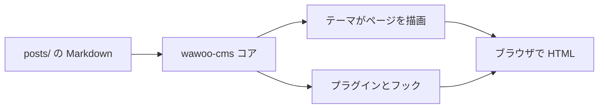

## この記事の目的

wawoo-cms を評価している人向けに、これが何か、何が得意か、そして
コンテンツ・カーネル・拡張という三層がどう組み合わさるかを説明します。
プロジェクトについての予備知識は前提にしません。

## かいつまんで

wawoo-cms は小さなファイルベース CMS です。markdown の記事、1 つの
有効テーマ、オプションのプラグイン API から成ります。データベースも
ビルド工程もフレームワークもありません。markdown バンドルを `posts/`
に置き、`config.local.php` にいくつか値を書けばサイトが動きます。


## 中身

- `includes/core/` — ブートストラップ、フック、マニフェスト、オートローダ、frontmatter、markdown、キャッシュ
- `themes/<name>/` — テーマは独自の CSS とテンプレートを持つ
- `plugins/<name>/` — プラグインは `plugin.json` にフックを宣言する
- `posts/*.md` — あなたのコンテンツ

## 限界はどこか

- テキスト中心のブログと小規模サイト向け。ページビルダーではない。
- 実行時には PHP（8.3+）が必要。コンテンツ自体は素の markdown。
- 大きなメディアライブラリはリポジトリに置かず、オブジェクトストア
  （`s3` プラグイン参照）に置くのがよい。

## テーマとプラグイン

テーマとプラグインは第一級市民です。各々が name、version、namespace、
entry クラス、依存制約を持つ JSON マニフェストを同梱します。コアは
依存関係を順に解決し、プラグインをテーマより先に起動します。

## フック

- `core.boot` — プラグイン／テーマのロード後に発火
- `post.load` — 記事をディスクから読むときに発火
- `post.html` — 記事のレンダリング済み HTML に対するフィルタ
- `theme.head` / `theme.head.after` / `theme.footer` — テーマレベルのフック
- `index.before_render` / `post.before_render` / `search.before_render`

## 図の例

wawoo-cms は Mermaid の図をテキストから描画できます（オプションの
`mermaid` プラグインが SVG に変換します）。



## コード例

フェンス付きコードブロックには言語ラベルと横スクロールが付きます。
```php
<?php
foreach (\Wawoo\Core\Posts::all() as $i => $post) {
    if ($i >= 3) { break; }
    echo $post["title"] . "\n";
}
```

## 次のステップ

- `php bin/wawoo doctor` で環境を確認
- `php bin/wawoo post:new hello-world` で記事を追加
- `php bin/wawoo plugin:link` でオプションプラグインを導入
