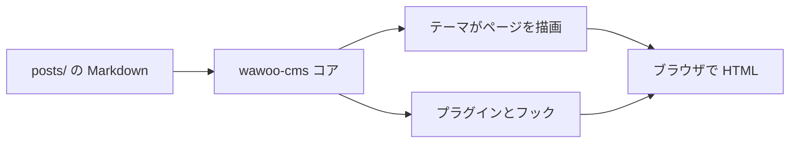

ようこそ！👋

あなたは **wawoo-cms** で動作するサイトを見ています。これは軽量でファイル
ベースの CMS で、プレーンテキストで考えたい人のために作られました。データ
ベースもビルドステップもフレームワークもありません — markdown bundle、
PHP 8.3、そして小さな hook システムだけです。

## これは何か

wawoo-cms はコンテンツをディスク上の markdown ファイルとして保存します。
各記事は `posts/<slug>/index.md` にあり、画像は同じフォルダに並べて
おけます。コアはルーティング、frontmatter、markdown レンダリング、キャッシュ
を担当します。それ以外のすべて — ナビゲーション、RSS、検索、コンタクト
フォーム — はオプションのプラグインです。

## 中身

- `includes/core/` — ブートストラップ、フック、オートローダ、frontmatter、
  markdown、キャッシュ、投稿/ページローダー
- `themes/<name>/` — テンプレート、CSS、任意の JS
- `plugins/<name>/` — `plugin.json` で宣言する任意機能
- `posts/<slug>/index.md` — あなたのコンテンツバンドル

## 限界はどこか

- テキスト中心のブログと小規模サイト向け。ページビルダーではない。
- 実行には PHP 8.3+ が必要。コンテンツ自体は素の markdown。
- 大規模なメディアライブラリはオブジェクトストレージ（`s3` プラグイン参照）
  に置く方がよい。

## テーマとプラグイン

テーマとプラグインは第一級市民です。それぞれが name、version、namespace、
エントリークラス、依存制約を持つ JSON マニフェストを携えます。コアは
依存関係を順に解決し、プラグインをテーマより先に起動します。

## フック

- `core.boot` — プラグイン／テーマのロード後に発火
- `post.load` — 記事をディスクから読み込むときに発火
- `post.html` — レンダリング済み記事 HTML へのフィルタ
- `theme.head` / `theme.head.after` / `theme.footer` — テーマレベルのフック
- `index.before_render` / `post.before_render` / `search.before_render`

## 小さな図

Mermaid 図はプレーンテキストから SVG にレンダリングされます。追加ツール
は不要です：



## コード例

フェンス付きコードブロックは自動的にシンタックスハイライトと横スクロール
を得ます：

```php
<?php
foreach (\Wawoo\Core\Posts::all() as $i => $post) {
    if ($i >= 3) { break; }
    echo $post['title'] . "\n";
}
```

## はじめに

1. `php bin/wawoo doctor` で環境を確認します。
2. 記事を作成：`php bin/wawoo post:new hello-world --title "Hello, world"`
3. `http://127.0.0.1:8801/post/hello-world` を開いてお楽しみください。🎉

お越しいただきありがとうございます — **あなたのページが速く読み込まれ、
markdown が整形式でありますように。**
