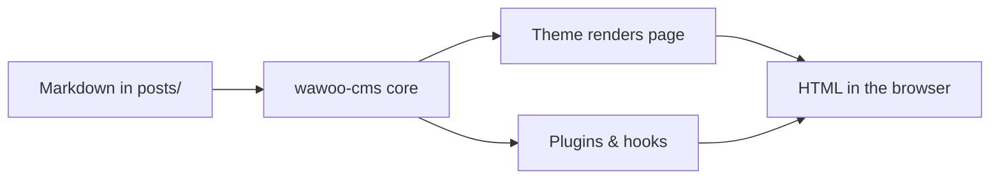

Hello and welcome! 👋

You are looking at a site powered by **wawoo-cms**, a lightweight, file-based
CMS for people who like to *think in plain text*. No database, no build step,
no framework — just markdown bundles, PHP 8.3, and a small hook system.

## What this is

wawoo-cms stores content as markdown files on disk. Each post lives in
`posts/<slug>/index.md`; images can sit next to the markdown in the same
folder. The core handles routing, frontmatter, markdown rendering and cache.
Everything else — navigation, RSS, search, contact forms — is an opt-in
plugin.

## What's inside

- `includes/core/` — bootstrap, hooks, autoloader, frontmatter, markdown,
  cache, posts/pages loader
- `themes/<name>/` — templates, CSS and optional JS
- `plugins/<name>/` — optional features declared in `plugin.json`
- `posts/<slug>/index.md` — your content bundles

## Boundaries

- Optimised for text-first blogs and small sites; not a page builder.
- Requires PHP 8.3+ at runtime; content itself is plain markdown.
- Large media libraries are better served by object storage (see the `s3`
  plugin) than by the repo.

## Themes & plugins

Themes and plugins are first-class citizens. Each ships a JSON manifest with
name, version, namespace, entry class and dependency constraints. The core
resolves dependencies in order and boots plugins before themes.

## Hooks

- `core.boot` — fires after plugins and themes are loaded
- `post.load` — fires when a post is read from disk
- `post.html` — filter on rendered post HTML
- `theme.head` / `theme.head.after` / `theme.footer` — theme-level hooks
- `index.before_render` / `post.before_render` / `search.before_render`

## A small diagram

Mermaid diagrams render from plain text into SVG. No extra tooling required:



## Code example

Fenced code blocks get syntax highlighting and horizontal scroll automatically:

```php
<?php
foreach (\Wawoo\Core\Posts::all() as $i => $post) {
    if ($i >= 3) { break; }
    echo $post['title'] . "\n";
}
```

## Getting started

1. Run `php bin/wawoo doctor` to check your environment.
2. Create a post: `php bin/wawoo post:new hello-world --title "Hello, world"`
3. Open `http://127.0.0.1:8801/post/hello-world` and enjoy. 🎉

Thanks for stopping by — **may your pages load fast and your markdown be
well-formed.**
