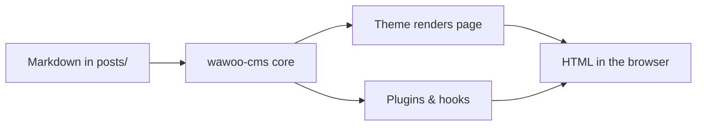

## What this post is for

If you are evaluating wawoo-cms, this page tells you what it is, what it is
good at, and how its three layers — content, kernel, and extensions — fit
together. It assumes no prior knowledge of the project.

## In short

wawoo-cms is a small, file-based CMS: markdown posts, one active theme,
and an opt-in plugin API. There is no database, no build step and no
framework. You drop a markdown bundle into `posts/`, set a few values in
`config.local.php`, and the site is live.


## What's in the box

- `includes/core/` — bootstrap, hooks, manifests, autoloader, frontmatter, markdown, cache
- `themes/<name>/` — themes ship their own CSS and templates
- `plugins/<name>/` — plugins declare hooks in `plugin.json`
- `posts/*.md` — your content

## Where the limits are

- Built for text-first blogs and small sites; not a page builder.
- PHP is required at runtime (8.3+); content itself is plain markdown.
- Large media libraries are best moved to an object store (see the `s3`
  plugin) rather than stored in the repo.

## Themes and plugins

Themes and plugins are first-class citizens. Each ships a JSON manifest
with name, version, namespace, entry class, and dependency constraints.
The core resolves dependencies in order and boots plugins before themes.

## Hooks

- `core.boot` — fires after plugins/themes are loaded
- `post.load` — fires when a post is read from disk
- `post.html` — filter on the rendered HTML of a post
- `theme.head` / `theme.head.after` / `theme.footer` — theme-level hooks
- `index.before_render` / `post.before_render` / `search.before_render`

## A small diagram

wawoo-cms renders Mermaid diagrams from plain text (the optional
`mermaid` plugin turns them into SVG):



## A code example

Fenced code blocks get a language label and horizontal scrolling:

```php
<?php
// fetch the three most recent posts and print their titles
foreach (\Wawoo\Core\Posts::all() as $i => $post) {
    if ($i >= 3) { break; }
    echo $post['title'] . "\n";
}
```

## Next steps

- Run `php bin/wawoo doctor` to check the environment.
- Add a post: `php bin/wawoo post:new hello-world`.
- Enable a feature from the optional plugins: `php bin/wawoo plugin:link`.
