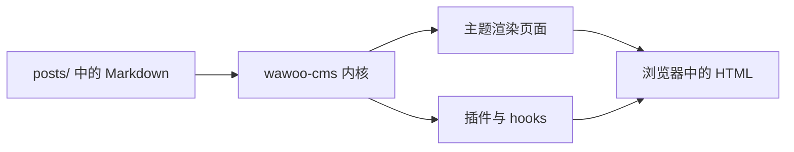

欢迎！👋

你正在浏览一个由 **wawoo-cms** 驱动的站点。它是一个轻量、文件型的
CMS，面向喜欢用纯文本思考的人。没有数据库、没有构建步骤、没有框架 —
只有 markdown bundle、PHP 8.3，以及一套小巧的 hook 机制。

## 这是什么

wawoo-cms 把内容存成磁盘上的 markdown 文件。每篇文章位于
`posts/<slug>/index.md`；图片可以放在 markdown 同目录下。内核负责路由、
frontmatter、markdown 渲染和缓存。其他一切 — 导航、RSS、搜索、联系表单
— 都是可选插件。

## 里面有什么

- `includes/core/` — 引导、hooks、自动加载、frontmatter、markdown、缓存、
  文章/页面加载器
- `themes/<name>/` — 模板、CSS 和可选 JS
- `plugins/<name>/` — 在 `plugin.json` 中声明的可选功能
- `posts/<slug>/index.md` — 你的内容 bundle

## 边界在哪里

- 面向文本优先的博客与小站；不是页面构建器。
- 运行时需要 PHP 8.3+；内容本身是纯 markdown。
- 较大的媒体库建议交给对象存储（见 `s3` 插件），而非存入仓库。

## 主题与插件

主题和插件是一等公民。各自携带 JSON manifest，包含 name、version、
namespace、入口类与依赖约束。内核按序解析依赖，先启动插件再启动主题。

## Hooks

- `core.boot` — 插件/主题加载完成后触发
- `post.load` — 从磁盘读取文章时触发
- `post.html` — 对文章渲染后 HTML 的过滤器
- `theme.head` / `theme.head.after` / `theme.footer` — 主题层 hook
- `index.before_render` / `post.before_render` / `search.before_render`

## 一个小图表

Mermaid 图表从纯文本渲染为 SVG，无需额外工具：



## 代码示例

围栏代码块自动获得语法高亮和横向滚动：

```php
<?php
foreach (\Wawoo\Core\Posts::all() as $i => $post) {
    if ($i >= 3) { break; }
    echo $post['title'] . "\n";
}
```

## 快速开始

1. 运行 `php bin/wawoo doctor` 检查环境。
2. 创建文章：`php bin/wawoo post:new hello-world --title "Hello, world"`
3. 打开 `http://127.0.0.1:8801/post/hello-world` 并开始使用。🎉

感谢你的到来 — **愿你页面加载飞快，markdown 永远格式正确。**
